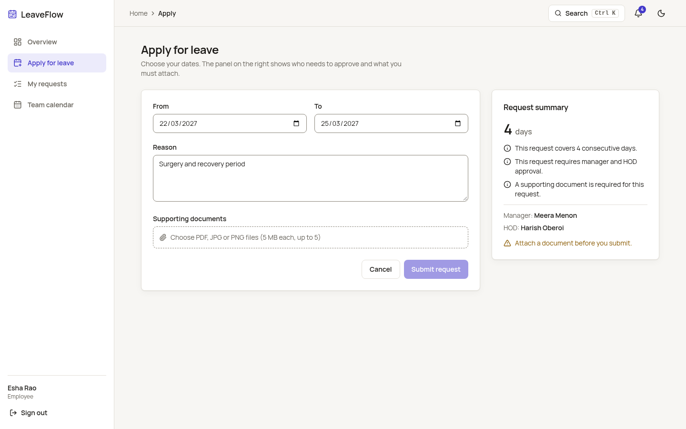
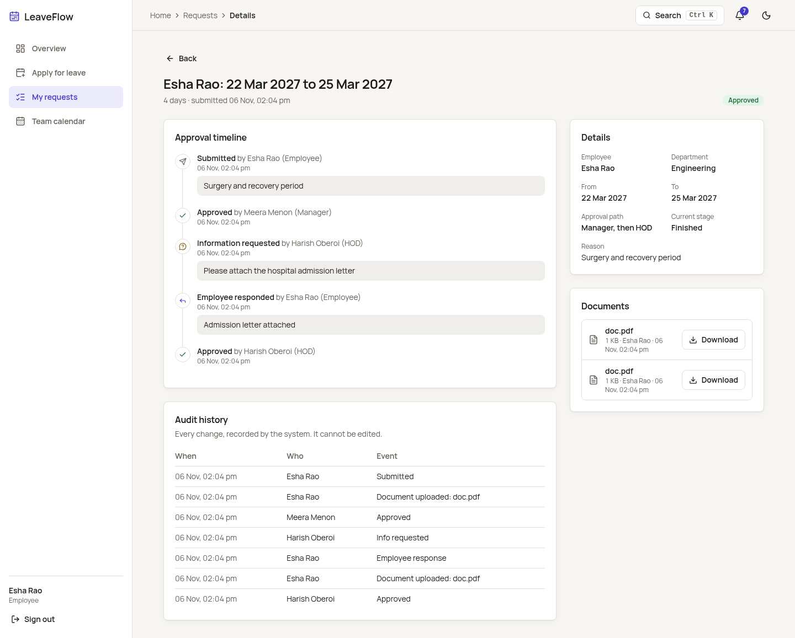
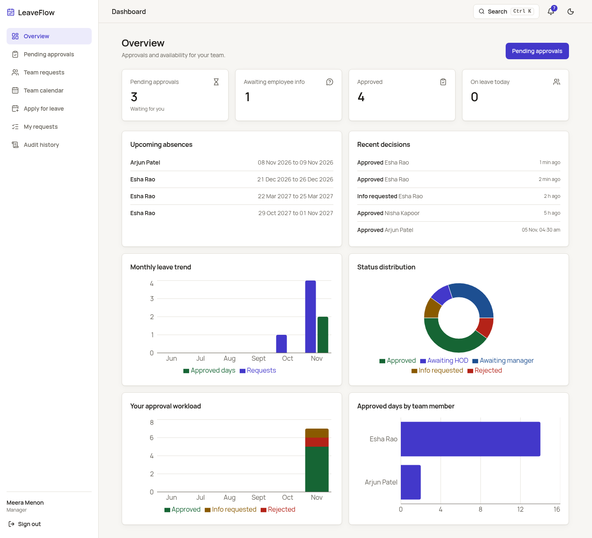

# LeaveFlow

A leave management system with role-based approvals, document uploads, an approval timeline, audit history, notifications, a team calendar and dashboards. Built as a Phase 1 (P0 + P1) assessment project on a React + Express + PostgreSQL monorepo.

## Live application
**URL: https://leaveflow.onrender.com**

Demo logins (password for all: `Password@123`): `employee@leaveflow.dev`, `manager@leaveflow.dev`, `hod@leaveflow.dev`. The login screen lists them too, because there is no public sign-up. The site runs on Render's free tier, so the first request after idle can take about a minute.





## Documentation
| Doc | What it covers |
|---|---|
| [docs/features.md](docs/features.md) | every feature and the main functions behind it |
| [docs/api-documentation.md](docs/api-documentation.md) | all endpoints, errors, examples |
| [docs/architecture.md](docs/architecture.md) | layers, key mechanisms, runtime shape |
| [docs/database-design.md](docs/database-design.md) | models, indexes, the audit trigger |
| [docs/security.md](docs/security.md) | what is protected and the known limits |
| [docs/testing.md](docs/testing.md) | how to run tests and what they cover |
| [docs/deployment.md](docs/deployment.md) | Render + Supabase + R2, rebuild and troubleshooting |
| [docs/ui-system.md](docs/ui-system.md) | design tokens and UI checks |
| [docs/decisions.md](docs/decisions.md) | decisions and assumptions |

## Features
**P0**
- Login with JWT in an HttpOnly cookie; roles EMPLOYEE, MANAGER, HOD enforced on the backend (scope checks per team/department)
- Apply for leave with PDF/JPG/PNG documents (5 MB, file signature verified), request history and status
- Manager approve / reject / request info; HOD stage only for leave longer than 3 working days
- Info-request loop that preserves the approval stage (employee response resumes the same stage)
- Transactional, race-safe transitions; validation and centralized error handling

**P1**
- Role-specific dashboards with Recharts (monthly trend, status split, approver workload, approved days per person), all from persisted data
- Approval timeline and audit history (append-only, enforced by a database trigger)
- Team calendar (month navigation, person filter, day detail; no reasons or documents exposed)
- In-app notifications (bell with unread count, list, click-through)
- Live validation preview from the server (days, approvals needed, document needed, overlap)
- Search, status/stage/date filters, sorting, pagination; loading, empty and error states; responsive layout, dark mode, Ctrl+K command palette

**Deferred (P2, not built):** AI policy copilot, AI summaries/recommendations/analytics queries, predictive insights, CSV/PDF export.

## Stack
Deployed on Render (one Docker service) with Supabase PostgreSQL and Cloudflare R2 for documents. React 19, Vite 8, Tailwind 4, shadcn-style components (Radix), TanStack Query, Axios, React Hook Form + Zod, Recharts, Lucide / Node 22+, Express 5, Prisma 6, PostgreSQL 16, Zod, multer, bcrypt, jsonwebtoken, Helmet, pino / Vitest, Supertest, Testing Library. The code is JavaScript (ESM), not TypeScript, to keep the 3-hour budget.

## Quick start
```bash
npm install
cp .env.example .env                 # set JWT_SECRET (32+ random chars)
npm run db:up                        # Postgres 16 in Docker on :5433 (or point DATABASE_URL at your own database)
npm run db:migrate                   # create schema (use db:deploy for existing migrations on CI/production)
npm run db:seed                      # demo organisation + requests in every state
npm run dev                          # API http://localhost:4000, web http://localhost:5173
```
API docs (Swagger UI): http://localhost:4000/api/docs

### Demo credentials (password for all: `Password@123`)
These are demo accounts for quick testing: there is no public registration, so assessors sign in with them. The data is throwaway.

| Role | Email | Notes |
|---|---|---|
| Employee | employee@leaveflow.dev (Esha Rao) | has a pending short request and one waiting for her reply |
| Manager | manager@leaveflow.dev (Meera Menon) | approves Esha, Arjun, Nisha; her own leave goes to the HOD |
| HOD | hod@leaveflow.dev (Harish Oberoi) | has one request awaiting HOD approval |
| Employee | arjun@leaveflow.dev, nisha@leaveflow.dev | other team members |

Seeded requests (dates are relative to the day you seed): a 2-day pending request, a 5-day request awaiting the manager, a 5-day request awaiting the HOD, a request in NEEDS_INFO, an approved short and an approved long request, and a rejected request, with matching notifications and audit rows. Running `db:seed` again resets requests; audit rows are append-only and are kept.

## Approval workflow
Duration is **inclusive working days: Saturdays and Sundays do not count** (Friday to Tuesday = 3). A weekend-only request is refused, as are past start dates and ranges over a year. It lives in `server/src/domain/leaveDuration.js` and is parsed from `YYYY-MM-DD` as UTC dates, so timezones cannot shift a day. The threshold (3), document rule and counting method come from the `LeavePolicy` table.

| Days | Path |
|---|---|
| 1 to 3 | `PENDING_MANAGER` -> manager approves -> `APPROVED` |
| 4 or more | document mandatory; `PENDING_MANAGER` -> manager approves -> `PENDING_HOD` -> HOD approves -> `APPROVED` |
| Rejection at any stage | `REJECTED` immediately (HOD can no longer act) |
| Info request (manager or HOD, comment required) | `NEEDS_INFO`, `approvalStage` unchanged; employee responds -> back to `PENDING_<same stage>` (no manager re-approval) |
| Employee cancels an open request | `CANCELLED` |

`status` and `approvalStage` are separate fields. The state machine is one pure function (`transition()` in `server/src/domain/leaveWorkflow.js`); the client never sends a status. Each transition runs in one database transaction with a guarded `UPDATE ... WHERE status = <expected> AND approvalStage = <expected>`, so concurrent approvals produce one success and the rest get 409. Timeline entry, audit row and notifications are written in the same transaction.

Who approves: the manager stage belongs to `employee.managerId`, the HOD stage to `department.hodId`. A manager's own leave is approved by the HOD in a single stage. HODs cannot apply for leave in Phase 1 (no approver above them).

## Architecture
```
Route -> middleware (session, role, validation, upload) -> controller -> service -> Prisma -> PostgreSQL
server/src/{domain,services,controllers,routes,middlewares,validators,utils,config,docs}
client/src/{features/{auth,leaves,dashboard,calendar,notifications,audit},components/{ui,shared,layouts},services,hooks,lib,routes}
Dockerfile, render.yaml            one image serving API + built client on Render
server/prisma/{schema.prisma,migrations,seed.js}
```
Business rules live in `server/src/domain` and `services`; React only renders what the API returns (including the preview and the per-request `permissions`). Access scope has one source of truth, `services/access.service.js`, used by lists and single-record checks. Out-of-scope records return 404, not 403. More in [docs/architecture.md](docs/architecture.md).

## Database
Department, User (self-referencing manager), LeaveRequest, LeaveDocument, ApprovalAction, AuditLog, Notification, LeavePolicy. See [docs/database-design.md](docs/database-design.md). Migrations: `server/prisma/migrations`.

## API
`/api/*`, consistent envelope `{ success, message, data, meta }` / `{ success:false, message, errors:[{field,message}] }`. Full list in [docs/api-documentation.md](docs/api-documentation.md) and Swagger at `/api/docs`.

## Environment variables
See [.env.example](.env.example): `DATABASE_URL`, `JWT_SECRET`, `JWT_EXPIRES_IN`, `CLIENT_ORIGIN`, `COOKIE_SAMESITE`, `STORAGE_BUCKET_API` + `R2_ACCESS_KEY_ID` + `R2_SECRET_ACCESS_KEY` (Cloudflare R2; all three set = documents go to R2, otherwise local disk via `UPLOAD_DIR`), `PORT`, `NODE_ENV`, and `VITE_API_URL` (frontend build only).

## Commands
`npm run dev | build | start | lint | test | test:coverage | db:up | db:migrate | db:deploy | db:seed`

## Testing
Server tests need a database `leaveflow_test` (see [docs/testing.md](docs/testing.md)). The suite covers the 20 required scenarios. Last run in this repo: server 46/46, client 8/8, lint clean, production build succeeds, plus a scripted browser run of the four-day lifecycle (apply with document, manager approve, HOD request info, employee respond, HOD approve) with desktop and 375px screenshots.

## Deployment
Live at https://leaveflow.onrender.com: one Docker service on Render (root `Dockerfile` + `render.yaml`) that serves the API and the built React app, with Supabase PostgreSQL (session pooler) and Cloudflare R2 for documents. The service was deployed by the project owner; the automated tests here run against local databases, not the live service. Steps, environment variables, rebuild and troubleshooting: [docs/deployment.md](docs/deployment.md). Without the three R2 variables, documents fall back to local disk, which is ephemeral on Render.

## Known limitations
- Weekends are excluded, but public holidays are not modelled; no leave balances/quotas.
- HODs cannot request leave. One department per user, one HOD per department.
- R2 storage (`server/src/utils/storage.js`) was smoke-tested manually (save, read, delete); automated tests use local disk.
- Notifications are in-app only (30 s polling, no email/push). No password reset or user administration UI; users come from the seed.
- In-memory rate limiter (per instance); no CSRF token (SameSite cookie + restricted CORS).
- Hallmark lint of signed-in pages ran on static snapshots (the linter cannot log in). Colour contrast was computed by hand (all pairs pass WCAG AA); realtimecolors.com's readout was not captured.

## Future (P2, deferred)
AI Leave Policy Copilot, AI request summaries and recommendations, natural-language analytics, predictive insights, CSV/PDF export, working-day counting with holiday calendars, leave balances.
